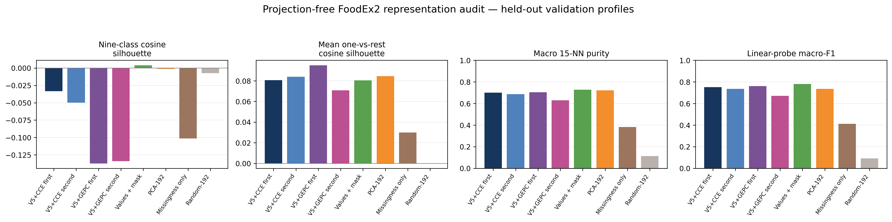
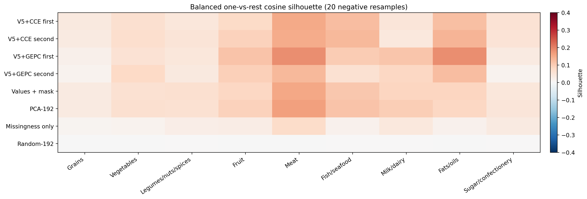
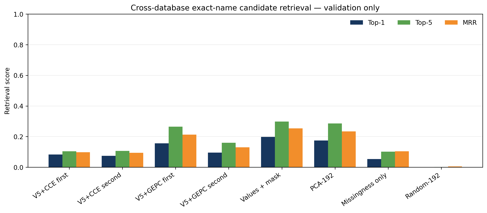

# Projection-free foundation-representation evidence audit

## Question

This audit tests whether the pretrained `[FOOD]` state contains transferable
food-composition structure beyond chance, while avoiding the claim that a
visually separated UMAP is itself evidence of a foundation model.  It adapts
the logic of a pretrained-CLS-versus-PCA analysis to the food-composition
setting, with additional controls for database-specific missingness.

The audit does **not** use food names, database source IDs, FoodEx2 labels, or
exact-name group IDs as model inputs.  FoodEx2 and source IDs are evaluation
labels only.  Exact-name groups are conservative name-based identity
candidates and are never treated as pooled biological observations.

## Predeclared representations

The comparison includes:

- first- and second-forward 192-D `[FOOD]` states from V5+CCE;
- first- and second-forward 192-D `[FOOD]` states from V5+GEPC;
- the 504-D numerical input view: 252 normalized values plus 252 visibility
  indicators;
- PCA-192, fitted on the training partition only from the numerical input view;
- the 252-D missingness vector alone;
- random 192-D Gaussian embeddings, with 20 independent null repeats.

PCA explains 96.86% of the training-view variance.  No UMAP coordinates enter
any metric below.

## Held-out category protocol

Nine relatively composition-homogeneous FoodEx2 level-1 categories were fixed
before evaluation: grains, vegetables, legumes/nuts/spices, fruit, meat,
fish/seafood, milk/dairy, fats/oils, and sugar/confectionery.

- Linear probes and neighbour reference sets use 33,754 labelled training
  profiles.
- General category metrics use 5,862 labelled validation profiles.
- Silhouette geometry uses a validation-only balanced panel with 191 profiles
  per class (1,719 total), determined by the smallest validation class.
- One-vs-rest silhouettes retain all 191 positives and use 20 balanced negative
  resamples per class.
- The cross-source category audit forces every validation query to retrieve its
  15 neighbours only from training profiles belonging to other databases.

## Category evidence

| Representation | 9-class silhouette | Mean one-vs-rest silhouette | Macro 15-NN purity | Cross-source macro purity | Linear macro-F1 |
|---|---:|---:|---:|---:|---:|
| V5+CCE first | -0.0333 | 0.0805 | 0.7000 | 0.3620 | 0.7524 |
| V5+CCE second | -0.0497 | 0.0840 | 0.6866 | 0.3602 | 0.7362 |
| **V5+GEPC first** | -0.1374 | **0.0951** | **0.7041** | **0.4868** | **0.7619** |
| V5+GEPC second | -0.1342 | 0.0708 | 0.6289 | 0.4041 | 0.6717 |
| Values + mask | **0.0041** | 0.0803 | **0.7287** | **0.5116** | **0.7801** |
| PCA-192 | -0.0013 | 0.0845 | 0.7217 | 0.4888 | 0.7349 |
| Missingness only | -0.1014 | 0.0299 | 0.3831 | 0.2127 | 0.4114 |
| Random-192 | -0.0075 | 0.0000 | 0.1127 | 0.1068 | 0.0923 |

Among learned representations, the first-forward GEPC state is the strongest.
It has the highest one-vs-rest silhouette, local category purity, cross-source
category purity, and linear-probe macro-F1.  Its cross-source category purity
(0.4868) is almost the PCA-192 result (0.4888), and its linear macro-F1 (0.7619)
exceeds PCA-192 (0.7349).  The uncompressed numerical view remains strongest
overall, so the result does not support a claim that the learned representation
universally contains more category information than its inputs.

The negative nine-class silhouettes and positive one-vs-rest results are not
contradictory.  Food categories are multi-modal across databases, processing
states, water content, and measurement coverage.  A linear decision boundary
or local neighbourhood can therefore carry category information without every
category forming one compact spherical cluster.

The second-forward state is not a better general-purpose representation.  It is
the state after task-specific prompt refinement and is useful for completion,
but both CCE and GEPC lose local category and linear-probe performance relative
to their first-forward states.  Future representation visualizations should use
the first-forward state unless a downstream experiment establishes otherwise.

## Database-source nuisance control

| Representation | Source silhouette | Source macro 15-NN purity | Source balanced accuracy | Within-category source silhouette |
|---|---:|---:|---:|---:|
| V5+CCE first | 0.1845 | 0.8001 | 0.9598 | 0.3080 |
| V5+GEPC first | -0.2052 | 0.7553 | 0.9749 | -0.0646 |
| Values + mask | 0.0822 | 0.8757 | 0.9916 | 0.2225 |
| PCA-192 | 0.0616 | 0.8538 | 0.9672 | 0.2107 |
| Missingness only | 0.3147 | 0.9825 | 0.9955 | 0.4098 |
| Random-192 | -0.0122 | 0.0927 | 0.0913 | -0.0132 |

GEPC reduces compact source neighbourhoods and within-category source
silhouette, but source remains highly linearly decodable.  Missingness alone is
almost perfectly source-decodable.  Database separation is therefore a batch
and measurement-coverage signal, not positive evidence of food semantics.

## Cross-database exact-name candidate retrieval

The retrieval panel contains 2,827 validation profiles in 1,070 exact-name
candidate groups across 22 databases.  For each query, all candidates from the
same database are excluded.  The task is to retrieve any profile in the same
candidate group from another database.

| Representation | Top-1 | Top-5 | MRR |
|---|---:|---:|---:|
| V5+CCE first | 0.0835 | 0.1040 | 0.0978 |
| V5+CCE second | 0.0743 | 0.1061 | 0.0936 |
| **V5+GEPC first** | **0.1563** | **0.2642** | **0.2126** |
| V5+GEPC second | 0.0948 | 0.1595 | 0.1306 |
| Values + mask | 0.1981 | 0.2985 | 0.2530 |
| PCA-192 | 0.1740 | 0.2855 | 0.2341 |
| Missingness only | 0.0527 | 0.1019 | 0.1044 |
| Random-192 | 0.0004 | 0.0014 | 0.0051 |

Across 20 random repeats, mean random Top-1 is 0.0010 and its maximum is
0.0021.  GEPC's 0.1563 Top-1 is therefore a real cross-database identity signal,
although it remains below the direct numerical and PCA baselines.  Because
exact-name groups are candidate duplicates rather than confirmed sample
identity, this result is evidence of cross-source compositional consistency,
not proof of exact biological equivalence.

## Relationship to external foundation-model evidence

Representation geometry is not the primary foundation-model claim.  The
stronger utility evidence remains the independently deduplicated Taiwan
transfer experiment:

| Method | Taiwan fixed-test zero-shot scaled-log MAE |
|---|---:|
| **V5+CCE** | **0.1881** |
| XGBoost | 0.2305 |
| RF | 0.2349 |
| KNN | 0.2777 |

The official external split now reserves 500 of the 696 cleaned foods for this
fixed test and uses the remaining 196 only for adaptation.  Fine-tuning the
pretrained V5+CCE model on 8, 32, and 128 Taiwan profiles gives 0.1880, 0.1819,
and 0.1694 respectively.  In the sparse-observation completion
audit, V5+CCE is also best at budgets of 5, 10, and 20 visible axes; tree models
catch up or pass it when substantially more context is available.

Taken together, the defensible conclusion is:

> Pretraining provides a clear external zero-shot and low-observation
> completion advantage.  The first-forward GEPC state additionally learns
> non-random, transferable food-category and cross-database identity structure,
> but it does not universally outperform direct numerical inputs or PCA and it
> is not fully source-invariant.

This is stronger and narrower than claiming that a clean UMAP or a silhouette
threshold alone proves foundation-model quality.

## Reproducibility and committed artifacts

Run `scripts/analyze_foundation_representation_evidence_v1.py` with the frozen
data directory, dependency-mask policy manifest, the two first-forward
embedding caches, and the validation-selected CCE and GEPC checkpoints.  The
script extracts second-forward states, fits PCA on training data only, and
writes all aggregate tables and figures.

The manifest records input hashes, fixed seed 20261110, split controls, PCA
variance, random-null intervals, and checkpoint hashes.  This Git directory
contains only aggregate metrics, figures, and the manifest.  It excludes raw
food data, food names, profile-level coordinates, embedding matrices, model
parameters, and predictions.
