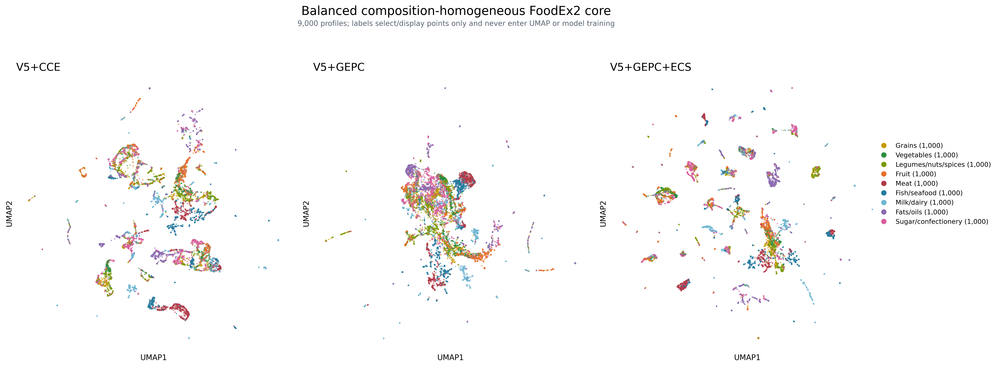
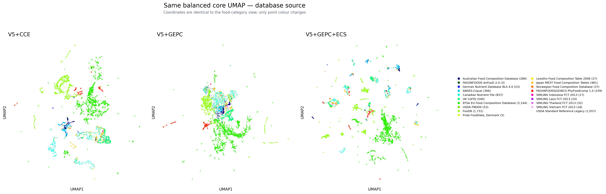

# V5+GEPC+ECS experiment

## Question

This experiment tests whether scGPT's elastic cell similarity (ECS) objective
can make the V5+GEPC `[FOOD]` representation more clearly organized by food
category without sacrificing numerical completion.

GEPC is the branch previously named MVC in this repository. In the official
scGPT integration code, `GEPC=True` enables the MVC decoder and trains from
`mvc_output`. ECS is a separate, parameter-free loss on the cell embedding.
The relevant implementations are the official
[scGPT model](https://github.com/bowang-lab/scGPT/blob/main/scgpt/model/model.py)
and
[integration example](https://github.com/bowang-lab/scGPT/blob/main/examples/finetune_integration.py).

## Controlled protocol

V5+GEPC+ECS starts from the same dependency-mask V5 final checkpoint as the
existing V5+GEPC branch. It does **not** continue from the already trained GEPC
checkpoint, because that would confound ECS with 20 additional epochs.

The model retains:

- V5's detached two-pass `[FOOD]` prompt;
- first- and second-pass axis-balanced completion losses;
- the GEPC inner-product decoder on first-forward `[FOOD]` and target-axis
  identity, with weight 0.25;
- 20 epochs, 337,048 tasks per epoch, batch size 128, AdamW, learning rate
  `1e-4`, and seed 20261005.

ECS uses the official integration settings: threshold 0.8 and weight 10. For a
batch of first-forward food representations, let

```text
S = ReLU(L2-normalize(H) @ L2-normalize(H)^T)
```

with the diagonal set to zero. The added loss is

```text
L_ECS = mean(1 - (S - 0.8)^2)
```

Minimizing this loss polarizes positive cosine similarities toward zero or one.
ECS adds no parameters. Food names, source IDs, FoodEx2 labels and legacy broad
families are not model inputs. Official inference remains the second-forward
target-token decoder. Checkpoint selection uses validation macro scaled-log MAE
only; no UMAP result is used for selection.

## Completion results

Epoch 10 is the validation-selected V5+GEPC+ECS checkpoint.

| Method | Partition | Macro scaled-log MAE | Macro scaled-log RMSE | Macro raw MAE |
|---|---|---:|---:|---:|
| V5+CCE | Validation | 0.223342 | **0.427485** | **0.249135** |
| **V5+GEPC** | Validation | **0.221731** | 0.428939 | 0.253572 |
| V5+GEPC+DAB | Validation | 0.223208 | 0.427609 | 0.253775 |
| V5+GEPC+ECS | Validation | 0.224050 | 0.429736 | 0.261380 |
| **V5+CCE** | Complete test | **0.301589** | 0.491016 | 0.313714 |
| V5+GEPC+DAB | Complete test | 0.303798 | **0.489222** | **0.312866** |
| V5+GEPC+ECS | Complete test | 0.304583 | 0.501781 | 0.340420 |
| V5+GEPC | Complete test | 0.305916 | 0.498142 | 0.346955 |

ECS slightly improves complete-test scaled-log MAE and raw MAE relative to pure
GEPC, but it does not beat CCE on the primary metric, DAB on scaled-log RMSE, or
CCE/DAB on raw MAE. It also weakens validation performance relative to pure
GEPC. There is no completion-based reason to select it.

## Representation results

The same predeclared balanced FoodEx2 core is used as in the preceding GEPC
audit: nine relatively composition-homogeneous level-1 classes, 1,000 profiles
per class, selected before fitting UMAP. Labels only select and colour points;
they never enter the model or UMAP optimization. Embeddings are first-forward
`[FOOD]` states with all observed numerical axes and no target query.

| Method | 192-D category purity | UMAP category purity | Category silhouette in UMAP | 192-D source purity | UMAP source purity |
|---|---:|---:|---:|---:|---:|
| V5+CCE | 0.677281 | **0.630163** | -0.108958 | 0.824504 | 0.797778 |
| **V5+GEPC** | **0.686778** | 0.622837 | -0.111216 | **0.780993** | **0.742519** |
| V5+GEPC+ECS | 0.665185 | 0.623319 | **-0.080217** | 0.814659 | 0.785644 |

ECS makes the two-dimensional layout appear more fragmented and improves the
category silhouette, but it does not improve local category purity. Relative
to pure GEPC:

- original 192-D category purity falls by 0.021593;
- UMAP category purity changes by only +0.000481;
- original 192-D source purity rises by 0.033667;
- UMAP source purity rises by 0.043126.

The source-coloured view shows that many of the visually cleaner islands are
database-specific. ECS has polarized the geometry, but the extra separation is
mainly aligned with source and missingness conventions rather than food
semantics.





## Decision

Reject V5+GEPC+ECS as the next model. It produces a visually more island-like
UMAP, but the islands are not more category-pure and are more source-dominated.
Pure V5+GEPC remains the strongest branch on original-space category
neighbourhood purity and gives the best category/source tradeoff; DAB suppresses
source slightly more but damages category purity. V5+CCE remains the selected
completion model on complete-test macro scaled-log MAE.

This negative result also explains why importing scGPT objectives does not
automatically reproduce scGPT-like cell-type clusters: ECS separates whichever
strong batch-level similarities are available. In this corpus, database
measurement coverage and missingness are stronger grouping signals than the
unsupervised FoodEx2 category.

## Artifacts and exclusions

- `gepc_ecs_training_history.csv` and training manifest: epoch-level aggregate
  training and validation evidence;
- `gepc_ecs_completion_metrics.csv` and evaluation manifest: frozen validation
  and complete-test metrics;
- `balanced_core_metrics.csv`: category/source results in 192-D and UMAP;
- `core_label_distribution.csv`, `balanced_core_provenance.csv`, and
  `balanced_core_database_sources.csv`: aggregate scope audit;
- two PNGs showing identical UMAP geometries under category and source colours.

No checkpoint, embedding matrix, profile-level coordinate table, profile-level
prediction, food name or raw composition value is committed.
