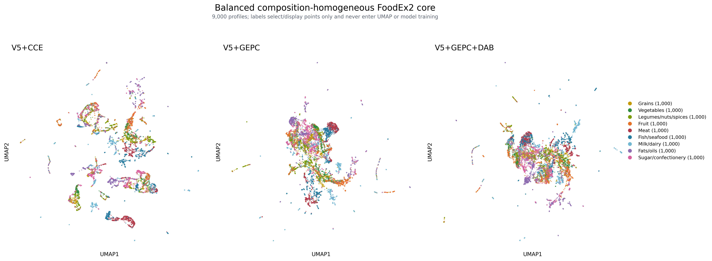

# V5+GEPC representation and UMAP audit

## What GEPC means here

The official scGPT integration code exposes GEPC through the MVC branch:
`do_mvc=config.GEPC`, passes `MVC=config.GEPC` during the forward call, and
computes the GEPC loss from `output_dict["mvc_output"]`. Therefore the branch
previously named **V5+MVC** in this repository is the V5+GEPC experiment; it is
not a different objective that needs to be retrained.

Our GEPC head receives the first-forward `[FOOD]` state and the raw target-axis
embedding. A sigmoid-transformed axis query is projected and paired with the
`[FOOD]` vector by an inner product to predict the normalized target value:

```text
first-forward [FOOD] + target-axis embedding -> GEPC target prediction
```

The head cannot read the contextual target-token state. GEPC receives weight
0.25 in addition to the two V5 completion losses. It is training-only; official
completion inference remains the second-forward target-token prediction.
Food names, source IDs and FoodEx2 labels are not model inputs.

The implementation follows the mechanism in the official
[scGPT model](https://github.com/bowang-lab/scGPT/blob/main/scgpt/model/model.py)
and its
[integration example](https://github.com/bowang-lab/scGPT/blob/main/examples/finetune_integration.py),
adapted from genes/cells to composition axes/foods.

## Existing GEPC result

V5+GEPC starts independently from the dependency-mask V5 final checkpoint and
continues for 20 epochs. The validation-selected checkpoint is epoch 19.

| Method | Partition | Macro scaled-log MAE | Macro scaled-log RMSE | Macro raw MAE |
|---|---|---:|---:|---:|
| V5+CCE | Validation | 0.223342 | **0.427485** | **0.249135** |
| **V5+GEPC** | Validation | **0.221731** | 0.428939 | 0.253572 |
| V5+CCE | Complete test | **0.301589** | **0.491016** | **0.313714** |
| V5+GEPC | Complete test | 0.305916 | 0.498142 | 0.346955 |

GEPC has the best validation primary metric but does not beat CCE on the fixed
complete-test panel. CCE therefore remains the selected completion checkpoint.

## Predeclared core-label UMAP

The original eight macro labels include nutritionally heterogeneous classes
such as composite dishes, sauces, beverages and special-purpose foods. To test
whether label breadth alone obscured the geometry, a narrower scope was fixed
before fitting the new UMAP:

- grains;
- vegetables;
- legumes/nuts/spices;
- fruit;
- meat;
- fish/seafood;
- milk/dairy;
- fats/oils;
- sugar/confectionery.

Each class contributes 1,000 profiles selected with seed 20261109, giving a
balanced 9,000-profile panel. Labels are assigned only from source categories
and conservative FoodEx2 crosswalks. They select and colour points but never
enter model training or UMAP fitting. Both representations are L2-normalized;
UMAP uses 15 neighbours, `min_dist=0.3`, Euclidean distance and the same seed.
The 192-D metrics are reported alongside the plot so visual layout cannot
substitute for representation evidence.

| Method | Space / label | 15-NN purity | Sampled silhouette |
|---|---|---:|---:|
| V5+CCE | 192-D food category | 0.677281 | **-0.011708** |
| **V5+GEPC** | 192-D food category | **0.686778** | -0.030736 |
| V5+CCE | UMAP food category | **0.630163** | **-0.108958** |
| V5+GEPC | UMAP food category | 0.622837 | -0.111216 |
| V5+CCE | 192-D database source | 0.824504 | 0.105424 |
| **V5+GEPC** | 192-D database source | **0.780993** | **-0.144699** |

GEPC modestly improves local category purity in the original representation
(+0.00950) and substantially lowers source-neighbour purity (-0.04351), but it
does not produce cleaner two-dimensional category islands. UMAP loses some of
the local category information that is present in 192 dimensions.

## Additional GEPC+DAB experiment

Because the remaining representation was source-structured, one additional
branch was trained from the same V5 parent for 20 epochs. It retains GEPC and
adds a 24-class, class-balanced source discriminator behind gradient reversal.
The source key is a training label only: it is never embedded or supplied as an
input. The discriminator minimizes source cross-entropy while the reversed
gradient makes the `[FOOD]` encoder maximize source confusion. The total loss is

```text
0.5 * first-pass completion MAE
+ 0.5 * second-pass completion MAE
+ 0.25 * GEPC MAE
+ 0.25 * source cross-entropy / log(24)
```

Selection still uses validation completion SLMAE, never UMAP. Epoch 17 is the
selected checkpoint.

| Method | Partition | Macro scaled-log MAE | Macro scaled-log RMSE | Macro raw MAE |
|---|---|---:|---:|---:|
| V5+CCE | Validation | 0.223342 | **0.427485** | **0.249135** |
| **V5+GEPC** | Validation | **0.221731** | 0.428939 | 0.253572 |
| V5+GEPC+DAB | Validation | 0.223208 | 0.427609 | 0.253775 |
| **V5+CCE** | Complete test | **0.301589** | 0.491016 | 0.313714 |
| V5+GEPC | Complete test | 0.305916 | 0.498142 | 0.346955 |
| V5+GEPC+DAB | Complete test | 0.303798 | **0.489222** | **0.312866** |

The DAB checkpoint keeps completion competitive but does not make food-category
geometry clearer:

| Method | 192-D category purity | UMAP category purity | 192-D source purity | UMAP source purity |
|---|---:|---:|---:|---:|
| V5+CCE | 0.677281 | **0.630163** | 0.824504 | 0.797778 |
| **V5+GEPC** | **0.686778** | 0.622837 | 0.780993 | 0.742519 |
| V5+GEPC+DAB | 0.653770 | 0.574170 | **0.779207** | **0.728289** |

DAB removes only a small additional amount of local source structure while
substantially reducing category purity. It is rejected. Pure GEPC is the best
representation branch in this experiment; CCE remains the best completion
model by the primary complete-test metric.



## Why this is less clustered than scGPT

1. A cell type is often a relatively coherent transcriptional programme,
   whereas food composition varies continuously with water content, cultivar,
   cut, fortification and processing. FoodEx2 also classifies by food identity
   and use, not only by nutrient composition.
2. The official scGPT integration workflow combines masked-value objectives
   with task-specific cell-type supervision and optional batch objectives. A
   cell-type-coloured UMAP after supervised fine-tuning is not directly
   comparable with our category-unsupervised completion encoder.
3. Database source changes both analytical coverage and missingness. Even when
   source ID is withheld, the observed-axis pattern acts as an indirect source
   signature.
4. UMAP preserves a local neighbour graph in two dimensions, not all 192-D
   relations. Here GEPC improves the original-space category neighbourhood but
   the independently fitted 2-D projection does not retain that improvement.
5. Category supervision would predictably make the picture cleaner, but then
   the plot would demonstrate supervised food classification rather than what
   the completion foundation model learned on its own.

The next defensible representation experiment is not a stronger category loss.
It is a source-invariant multi-view objective: use cross-database, exact-name
matched profiles as positives, add random observed-axis dropout to break
missingness fingerprints, retain GEPC, and keep unmatched foods out of the
contrastive term. A separate supervised FoodEx2 fine-tune is appropriate only
if food categorization itself becomes the downstream task.

## Committed artifacts

- `balanced_core_metrics.csv`: category and source metrics in 192-D and UMAP.
- `core_label_distribution.csv` and `balanced_core_provenance.csv`: aggregate
  scope and label-provenance audit.
- `gepc_dab_training_history.csv` and manifests: aggregate training evidence.
- `gepc_dab_completion_metrics.csv`: validation and complete-test result.
- `source_training_summary.csv`: aggregate DAB class support and weights.
- `umap_balanced_core_cce_gepc_dab.png`: the final comparison figure.

No checkpoint, embedding matrix, profile-level coordinates, profile-level
prediction, food name or raw composition value is committed.
