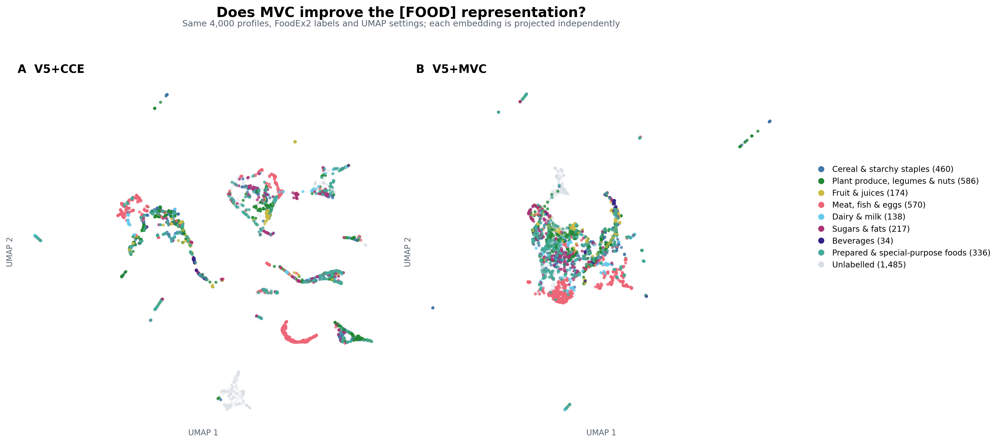
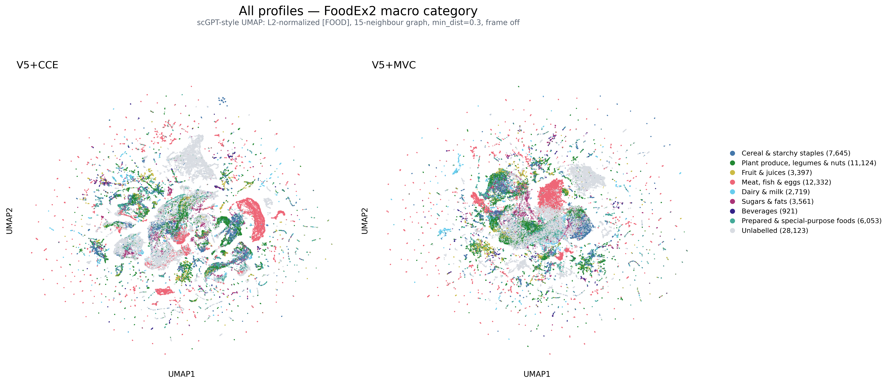
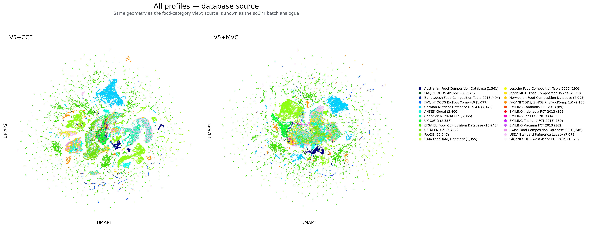

# V5+MVC and `[FOOD]` UMAP experiment

## Question

This experiment tests whether the weak food-category separation in the existing
V5+CCE UMAP is mainly caused by the absence of a masked-value prediction from
the global `[FOOD]` representation (MVC).

## Matched intervention

V5+MVC and V5+CCE start from the same dependency-mask V5 final checkpoint.
V5+MVC adds the scGPT-style bilinear decoder

```text
first-forward FOOD state + raw target-axis embedding -> normalized target value
```

The target query is `sigmoid(Wq(axis_embedding))`, and its projected inner
product with the first-forward `[FOOD]` state gives the MVC prediction. The MVC
head cannot read the contextual target-token state. Gradients are allowed to
flow into `[FOOD]`; the detached prompt used by V5's second pass is unchanged.

Training uses the same dependency mask, 337,048 axis-balanced tasks per epoch,
batch size 128, AdamW, learning rate `1e-4`, seed `20261005`, and 20 continuation
epochs. The total loss is

```text
0.5 * first-pass completion MAE
+ 0.5 * second-pass completion MAE
+ 0.25 * MVC MAE
```

CCE is absent from this branch. Official completion inference remains the V5
second-pass target-token decoder; MVC is training-only. The branch adds 73,920
parameters (2,131,045 total versus 2,057,125 for V5/V5+CCE).

## Completion result

| Method | Partition | Selected epoch | Macro scaled-log MAE | Macro scaled-log RMSE | Macro raw MAE |
|---|---|---:|---:|---:|---:|
| V5 | Validation | 14 | 0.223905 | 0.430553 | 0.263802 |
| V5+CCE | Validation | 17 | 0.223342 | **0.427485** | **0.249135** |
| **V5+MVC** | Validation | 19 | **0.221731** | 0.428939 | 0.253572 |
| V5+CCE | Complete test | 17 | **0.301589** | **0.491016** | **0.313714** |
| V5+MVC | Complete test | 19 | 0.305916 | 0.498142 | 0.346955 |

MVC improves validation scaled-log MAE by 0.72% relative to CCE, but the
validation-selected MVC checkpoint is 1.43% worse on complete-test scaled-log
MAE. Its complete-test raw MAE is 10.60% worse. V5+CCE therefore remains the
selected completion model.

## Representation result

Both models use their first-forward `[FOOD]` state. The comparison fixes the
same 4,000 validation profiles, 2,515 auditable FoodEx2-labelled profiles,
eight macro classes, empty target-query grid, and UMAP settings
(`n_neighbors=15`, `min_dist=0.15`, cosine metric, seed `20261027`). Each model
is projected independently.

| Label and space | Metric | V5+CCE | V5+MVC | MVC change |
|---|---|---:|---:|---:|
| Macro food class, original 192-D | 15-NN purity | 0.551862 | **0.564056** | +0.012194 |
| Macro food class, original 192-D | Silhouette | -0.146140 | **-0.073010** | +0.073130 |
| Macro food class, UMAP 2-D | 15-NN purity | **0.531796** | 0.525275 | -0.006521 |
| Macro food class, UMAP 2-D | Silhouette | -0.211778 | **-0.057559** | +0.154219 |
| Detailed FoodEx2, original 192-D | 15-NN purity | 0.469901 | **0.484188** | +0.014288 |
| Database source, original 192-D | 15-NN purity | 0.783830 | **0.699404** | -0.084427 |

MVC modestly improves category structure in the original embedding: local
macro-category purity and silhouette both improve, and detailed-category local
purity also rises. At the same time, database-source purity falls substantially,
so the representation is less dominated by source-specific structure.

The visible UMAP is still not cleanly separated into food-category islands.
Its category silhouette becomes much less negative, but 2-D local purity falls
slightly. Therefore the absence of MVC was a contributor to source-dominated
geometry, not the main explanation for the weak food-category UMAP. Nutrient
completion does not uniquely determine FoodEx2 category, and the training
objective still contains no food-category supervision.



## All-profile scGPT-style rendering

The visual check was repeated on every development profile: 64,700 training
profiles plus 11,175 validation profiles, for 75,875 points in total. Of these,
47,752 have an auditable FoodEx2 level-1 label. This view follows the
[official scGPT integration example](https://github.com/bowang-lab/scGPT/blob/main/examples/finetune_integration.py)
more closely than the earlier 4,000-profile figure:
the `[FOOD]` vectors are L2-normalized, a 15-neighbour UMAP is fitted with
`min_dist=0.3`, the plot frame and ticks are removed, food category is treated
as the cell-type analogue, and database source is shown as the batch analogue.

| All-profile UMAP label | Metric | V5+CCE | V5+MVC | MVC change |
|---|---|---:|---:|---:|
| Macro food category | 15-NN purity | **0.673586** | 0.671531 | -0.002055 |
| Macro food category | sampled silhouette | **-0.076982** | -0.096567 | -0.019585 |
| Detailed FoodEx2 | 15-NN purity | **0.617257** | 0.602912 | -0.014345 |
| Detailed FoodEx2 | sampled silhouette | -0.280597 | **-0.191408** | +0.089190 |
| Database source | 15-NN purity | 0.770130 | **0.704550** | -0.065580 |

The full-profile result is more decisive than the 4,000-profile visual: MVC
does not consistently improve food-category separation under the scGPT-style
UMAP. Its clearest effect is to reduce local database-source separation by 6.56
percentage points. Category purity is essentially unchanged at the macro level
and lower at the detailed level. This supports the conclusion that missing MVC
was not the main cause of the weak category UMAP.





## Artifacts and exclusions

- `artifacts/completion_metrics.csv`: validation and complete-test metrics.
- `artifacts/representation_structure_metrics.csv`: all category/source metrics
  in original and UMAP spaces.
- `artifacts/mvc_training_history.csv`: aggregate epoch-level losses and
  validation metrics.
- `artifacts/mvc_training_manifest.json` and
  `artifacts/mvc_evaluation_manifest.json`: frozen protocol, hashes and selected
  checkpoint summaries.
- `artifacts/umap_v5_cce_vs_v5_mvc.png`: fixed-sample comparison.
- `artifacts/umap_manifest.json`: hashes and exact UMAP configuration.
- `artifacts/umap_all_profiles_food_category.png`: all 75,875 profiles,
  FoodEx2 macro-category rendering.
- `artifacts/umap_all_profiles_database_source.png`: the same geometries by
  database source.
- `artifacts/full_profile_umap_metrics.csv`, `database_sources.csv`, and
  `full_profile_umap_manifest.json`: aggregate full-profile evidence and
  scGPT-style settings.

No checkpoint, raw data, profile-level prediction, sampled embedding, or
profile-level coordinate table is committed.
