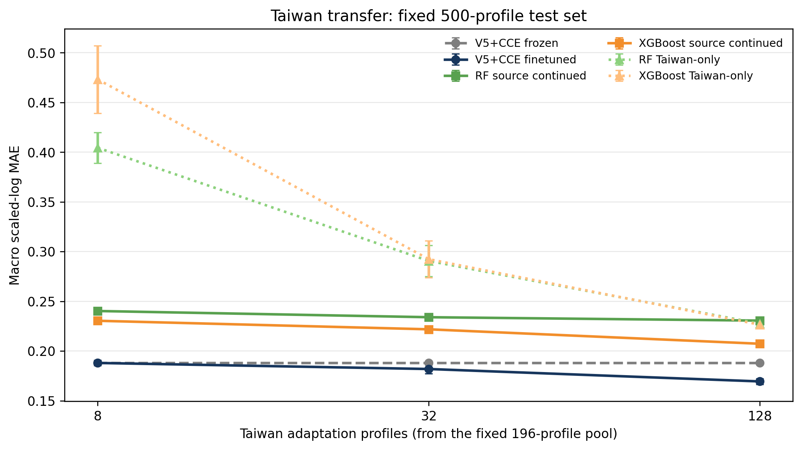

# Taiwan deduplicated transfer analysis: 500-test / 196-adaptation protocol

## Frozen split

The conservative external-overlap audit leaves 696 Taiwan foods (575 lexical
identity groups), 41,927 profile-axis jobs, and 80 target axes.  This revision
uses the user-specified split:

- **500 foods** form one fixed test set for both zero-shot and every few-shot
  evaluation, comprising 30,267 profile-axis jobs across all 80 axes;
- the remaining **196 foods** form the only few-shot adaptation pool;
- `identity_group_key` is an indivisible split unit, so no lexical identity
  group occurs in both adaptation and test;
- the split seed remains 20261026;
- the 8-, 32-, and 128-shot subsets are nested within each of three seeds;
- subset construction uses missingness-only axis coverage before random fill,
  never target values or test error.

This protocol supersedes the former 400-test / 296-adaptation Taiwan analysis.

## Zero-shot results on the fixed 500-food test

| Method | Macro scaled-log MAE | Macro scaled-log RMSE | Macro raw MAE |
|---|---:|---:|---:|
| **V5+CCE frozen** | **0.188126** | **0.360484** | 0.304127 |
| XGBoost | 0.230483 | 0.364657 | **0.275441** |
| RF | 0.234941 | 0.364950 | 0.295003 |
| KNN | 0.277715 | 0.436750 | 0.446374 |

V5+CCE reduces the primary error by 18.38% relative to XGBoost and by
19.93% relative to RF.  A paired 2,000-draw profile bootstrap gives V5+CCE minus
XGBoost `-0.04223` (95% interval `[-0.04664, -0.03787]`) and V5+CCE minus RF
`-0.04671` (`[-0.05103, -0.04247]`).  All 2,000 draws favour V5+CCE for both
comparisons.

## Few-shot results

All rows below use the same fixed 500-food test.  Values are mean macro
scaled-log MAE over seeds 20261027--20261029; parentheses give the run-to-run
standard deviation.

| Method | 8 shot | 32 shot | 128 shot |
|---|---:|---:|---:|
| **V5+CCE finetuned** | **0.187997 (0.002686)** | **0.181907 (0.004458)** | **0.169423 (0.003023)** |
| V5+CCE frozen | 0.188126 | 0.188126 | 0.188126 |
| XGBoost source continued | 0.230430 (0.000945) | 0.221841 (0.002826) | 0.207323 (0.000466) |
| RF source continued | 0.240255 (0.002347) | 0.234014 (0.001003) | 0.230601 (0.000299) |
| RF Taiwan-only | 0.404460 (0.015401) | 0.290637 (0.015723) | 0.227540 (0.001757) |
| XGBoost Taiwan-only | 0.473211 (0.033950) | 0.292385 (0.018382) | 0.226505 (0.001405) |

Eight-shot fine-tuning is effectively tied with the frozen model.  At 32 and
128 shots, fine-tuning reduces the frozen-model error by 3.31% and 9.94%.
At 128 shots it is 18.28% better than the strongest tree alternative,
source-pretrained XGBoost continuation.

The pretrained tree controls matter: they distinguish a generic benefit of
source-data pretraining from a benefit specific to the Transformer.  They
improve substantially over Taiwan-only tree fitting, especially at 8 and 32
shots, but do not close the gap to frozen or fine-tuned V5+CCE.

## Interpretation

The 500/196 protocol strengthens the external-transfer claim because 71.8% of
the cleaned external foods are reserved for testing, while every adaptation
method receives at most 128 of the remaining 196 foods.  The conclusion is
stable relative to the earlier split:

1. the frozen foundation model has a clear zero-shot advantage on unseen
   Taiwan foods;
2. very small fine-tuning sets do not reliably improve it;
3. 32 and 128 external profiles produce increasing benefit;
4. source-pretrained RF/XGBoost are stronger controls than Taiwan-only trees,
   yet remain worse than the Transformer under the same adaptation counts.

This experiment measures composition completion only.  It does not use food
names, database source IDs, or Taiwan identity labels as model inputs.

## Reproducibility and artifacts

The experiment uses the unchanged numerical normalization, dependency-family
mask, V5+CCE checkpoint, baseline configurations, 20-epoch neural fine-tuning
protocol, and 20-tree/round continuation protocol.  The manifest hashes the
four completed input runs and the frozen split.

Only aggregate metrics, run summaries, the bootstrap table, and the figure are
committed.  Raw Taiwan data, food names, per-profile predictions, model
parameters, and the row-level split ledger are excluded.
