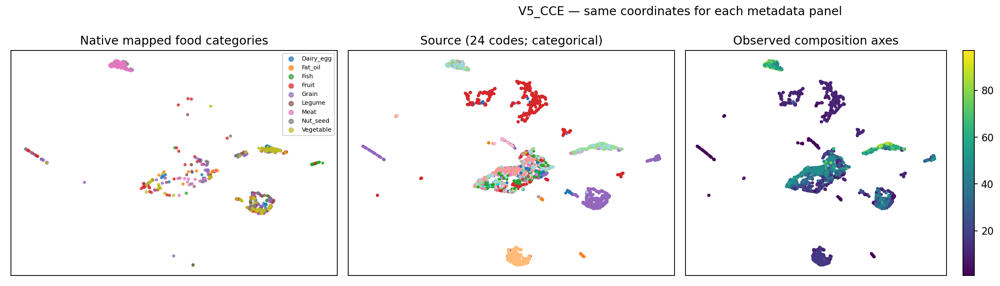
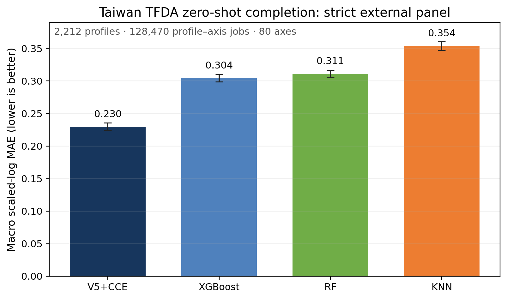
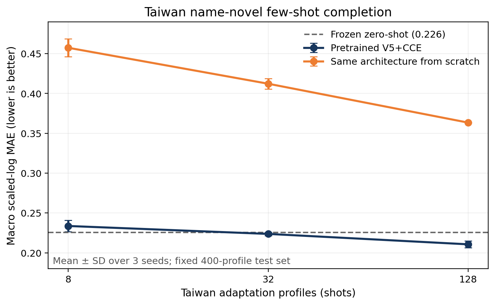
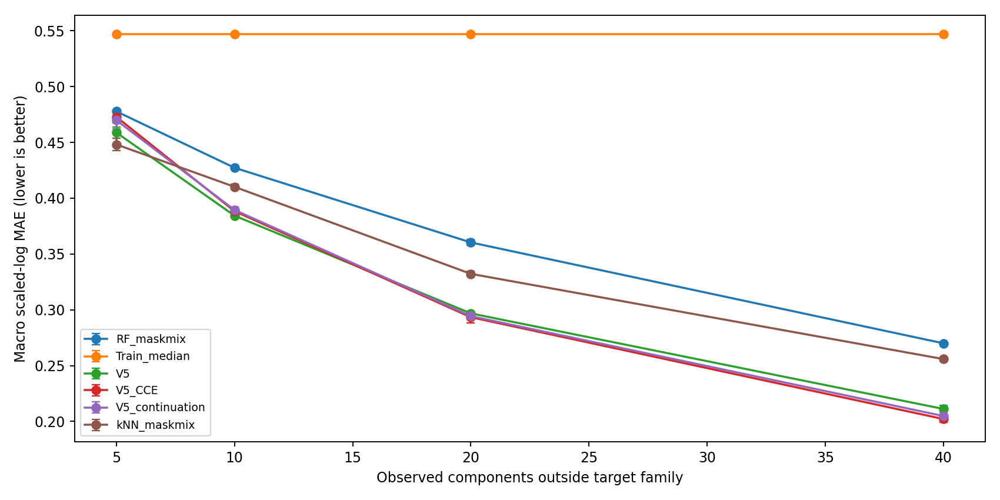
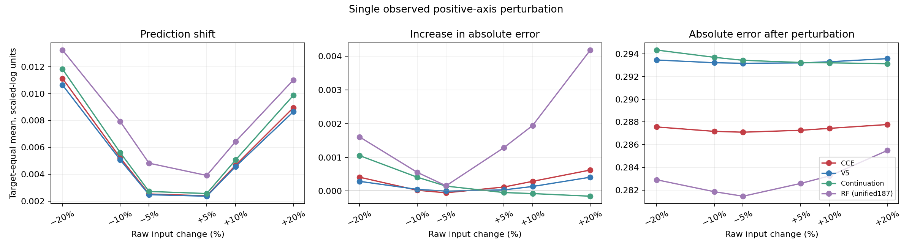
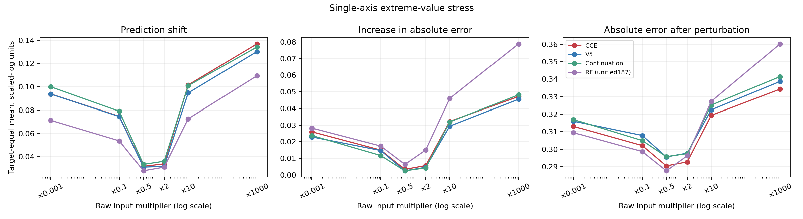

# Evidence for Transfer, Few-Shot Adaptation, and Robustness in the Food-Composition Foundation Model

**Version:** 26 October 2026  
**Primary model:** V5+CCE  
**Scope:** UMAP representations, Taiwan TFDA zero-shot transfer, Taiwan few-shot adaptation, sparse-observation completion, and full-validation sensitivity analysis

## Executive summary

This report combines five experiments to answer three questions: whether the model transfers to a database not used for training, whether pretraining reduces the amount of labelled external data needed for adaptation, and how the model behaves when observations are sparse or perturbed.

The main findings are:

1. **Taiwan TFDA zero-shot evaluation is the clearest external-transfer evidence.** The frozen V5+CCE model used no Taiwan records for training, tuning, checkpoint selection, or normalization. On the strict panel of 2,212 foods, 128,470 food-axis jobs, and 80 axes, its macro scaled-log MAE was **0.2296**. This was **24.6%, 26.2%, and 35.1%** lower than XGBoost, RF, and KNN. All three paired 2,000-replicate profile-bootstrap intervals were fully below zero.
2. **The new Taiwan few-shot experiment shows a large benefit from pretrained initialization.** With 8, 32, and 128 Taiwan adaptation profiles whose normalized English names did not exactly match pretraining names, the pretrained model reduced scaled-log MAE by **48.9%, 45.7%, and 42.0%** relative to the same architecture trained from random initialization. With 128 adaptation profiles, the pretrained model also improved the fixed-test zero-shot score from 0.2258 to 0.2107.
3. **A tiny adaptation set does not necessarily improve a strong zero-shot model.** Eight-shot fine-tuning averaged 0.2337 and was slightly worse than the zero-shot value of 0.2258. The 32-shot improvement was small, while 128 shots gave the first clear gain across the three metrics. Target coverage and sampling variance matter at very low sample sizes.
4. **Sparse-observation completion supports useful cross-axis structure under moderate sparsity.** On 12 fixed targets, V5+CCE outperformed retrained RF and KNN baselines with 10, 20, and 40 visible components. KNN was best with only five visible components. This is internal exploratory evidence from the original validation data.
5. **UMAP reveals category, source, and observation-coverage structure, but it does not establish a representation advantage by itself.** V5+CCE improved modestly over V5, while the direct nutrient-value-plus-mask representation remained stronger on category metrics. Missingness alone predicted data source very well, showing that database coverage is a material confounder.
6. **Full-validation perturbation responses were generally smooth, while robustness depended on the metric and condition.** Under single-input ±10% perturbations, CCE had small mean error increases. Under input deletion, CCE degraded much less than RF. RF had slightly lower clean error, so its absolute perturbed error could still be lower under small perturbations. Prediction shift, error increase, and error after perturbation need separate reporting.

Taken together, **external zero-shot performance plus the external pretrained-versus-random few-shot ablation provide the strongest current evidence for a foundation-model benefit**. UMAP, sparse-observation completion, and sensitivity analysis explain what structure the system uses, where it helps, and where it fails.

## 1. Shared setup

### 1.1 Model

V5+CCE is a single numerical Transformer executed twice:

- three layers, hidden dimension 192, and six attention heads;
- ReGLU feed-forward blocks with width 256;
- layer- and head-specific ordered axis-pair attention bias;
- a first pass over visible axis/value tokens and target axis/[MASK] tokens, producing target predictions and a contextual `[FOOD]` representation;
- a second pass that replaces the initial `[FOOD]` vector with `detach(h_food)` and reuses the same Transformer; second-pass target outputs are the official predictions;
- a CCE stage that creates two dropout stochastic views of the first-pass `[FOOD]` representation and applies a contrastive cell embedding loss;
- no food name, source, food-family label, or profile identifier as model input.

The complete checkpoint is called **V5+CCE** below. The matched continuation control shows that additional training also explains part of the change from V5, so the report does not attribute every V5+CCE difference to the CCE loss alone.

### 1.2 Metrics

For axis `a`, the fixed scale `s_a` is the median of strictly positive values in the original training data. Values are transformed as

\[
z_{i,a}=\log\left(1+\frac{y_{i,a}}{s_a}\right).
\]

Errors are averaged within each axis and then equally across evaluated axes:

\[
\mathrm{SLMAE}
=\frac{1}{|\mathcal A|}\sum_{a\in\mathcal A}
\frac{1}{N_a}\sum_i |\hat z_{i,a}-z_{i,a}|.
\]

Macro scaled-log MAE is the primary metric. Macro scaled-log RMSE gives more weight to large normalized misses. Macro raw MAE remains in the original concentration scale and is more affected by high-concentration axes. Lower is better for all metrics.

### 1.3 Evidence hierarchy

| Experiment | Data role | Training performed | Main question | Evidence level |
|---|---|---:|---|---|
| Taiwan zero-shot | Independent external database | No | Does the frozen model transfer across databases? | Strong |
| Taiwan few-shot | Independent database with fixed test set | Yes | Does pretraining improve sample efficiency? | Strong, with three seeds |
| Sparse-observation completion | Exploratory original-validation panel | No | Which model works with fewer visible values? | Moderate |
| UMAP | Original train/validation representations | No | What separable structure is present? | Descriptive |
| Sensitivity analysis | Full original-validation diagnostic | No | How do perturbations affect predictions and errors? | Descriptive robustness evidence |

## 2. UMAP and representation structure

### 2.1 Method

The first-pass `[FOOD]` state was extracted for 75,875 training and validation profiles using all observed composition values and an empty target-query grid. Food names and source labels were not model inputs. UMAP projected these high-dimensional states into two dimensions; it was not used for training or checkpoint selection.

The same coordinates are colored by mapped food category, source, and number of observed composition axes. Several source clusters and coverage gradients are clear. Food categories cluster in some regions but do not form universally separated islands.

### 2.2 Quantitative checks

| Representation | k=10 purity | k=10 macro purity | Linear macro-F1 | Balanced accuracy | Cosine silhouette |
|---|---:|---:|---:|---:|---:|
| Raw nutrients + mask | **0.797** | **0.756** | **0.861** | **0.860** | 0.089 |
| PCA-50 | 0.768 | 0.725 | 0.723 | 0.740 | **0.111** |
| V5 | 0.719 | 0.667 | 0.757 | 0.776 | -0.052 |
| V5+CCE | 0.733 | 0.689 | 0.774 | 0.784 | 0.066 |
| V5 continuation | 0.734 | 0.682 | 0.773 | 0.790 | approximately 0.000 |

V5+CCE improved k=10 purity by about 1.4 percentage points and macro purity by about 2.2 points relative to V5. The continuation control was similar, and the raw nutrient-plus-mask representation was stronger overall. The FOOD embedding therefore did not extract category structure that was uniformly superior to the original numerical representation.

Missingness alone reached approximately 0.597 category macro-F1 and 0.967 source balanced accuracy. A material part of the visible UMAP structure is therefore related to which axes each database measures.

Across UMAP seeds, ten-neighbour overlap was about 0.721. When 10%, 30%, and 50% of observed inputs were randomly hidden, mean V5+CCE cosine similarity to the full-input representation was approximately 0.980, 0.932, and 0.853; ten-neighbour overlap was approximately 0.693, 0.420, and 0.244. Broad local structure was reproducible, while exact coordinates and fine neighbourhoods were not.

**Conclusion:** UMAP is useful for representation auditing and hypothesis generation. It shows category, source, and coverage information in the embedding, but it is not the primary evidence for transfer.

## 3. Taiwan TFDA zero-shot external validation

### 3.1 Protocol

The Taiwan Food and Drug Administration database was used for evaluation only:

- zero Taiwan profiles were used for model fitting;
- Taiwan data were not used for hyperparameter tuning, checkpoint selection, or normalizer fitting;
- target axes required a compatible mapping, sample-backed values, and at least 20 Taiwan foods;
- the final panel covered 80 axes and eight target families;
- the full target family was hidden in each completion task;
- V5+CCE used its frozen checkpoint; RF, XGBoost, and KNN were refitted only on the original training data with fixed settings;
- metrics were averaged within axis and then equally across the 80 axes, without source or same-name aggregation.

The strict panel contained 2,212 foods and 128,470 food-axis jobs. A name-novel panel contained 1,789 foods and 107,482 jobs whose normalized English names did not exactly match the pretraining names. This is more informative than source-ID novelty, although it does not prove complete semantic novelty.

### 3.2 Results

| Method | Scaled-log MAE | Scaled-log RMSE | Raw MAE |
|---|---:|---:|---:|
| **V5+CCE** | **0.2296** | **0.4260** | **0.3658** |
| XGBoost | 0.3044 | 0.4570 | 0.3717 |
| RF | 0.3111 | 0.4518 | 0.3882 |
| KNN | 0.3539 | 0.5395 | 0.5419 |

Relative scaled-log MAE reductions versus XGBoost, RF, and KNN were 24.6%, 26.2%, and 35.1%. Profile-level paired bootstrap comparisons were:

| Comparator | V5+CCE minus comparator | 95% paired bootstrap interval | Probability V5+CCE is better |
|---|---:|---:|---:|
| XGBoost | -0.0748 | [-0.0773, -0.0723] | 1.000 |
| RF | -0.0815 | [-0.0841, -0.0789] | 1.000 |
| KNN | -0.1243 | [-0.1281, -0.1207] | 1.000 |

The name-novel panel gave the same ranking. Its V5+CCE, XGBoost, RF, and KNN scaled-log MAEs were 0.2311, 0.3071, 0.3144, and 0.3587.

Raw MAE requires a narrower claim. V5+CCE was 0.0061 lower than XGBoost at the point estimate, but the paired interval was [-0.0126, 0.0008] and crossed zero. The external advantage is most clearly established for scaled-log MAE and scaled-log RMSE.

## 4. Taiwan TFDA few-shot adaptation

### 4.1 New experiment

The experiment used only the 1,789 Taiwan profiles without an exact normalized English-name match to pretraining. A fixed, label-independent random split assigned 400 profiles to the test set and 1,389 to the adaptation pool. The test set contained 23,109 food-axis jobs and all 80 axes.

Two initializations were compared:

1. **Pretrained:** the V5+CCE checkpoint;
2. **Scratch:** the same architecture, objective, optimizer, and adaptation data with random parameter initialization.

Within each seed, adaptation subsets were nested as `8 subset 32 subset 128`. Seeds were 20261026, 20261027, and 20261028. Each run used 20 epochs, AdamW, learning rate `1e-4`, and batch size 128. The final epoch was reported without test-based checkpoint selection or mid-experiment changes.

A shot is a food profile, not a single axis label. Because Taiwan profiles are sparse, the eight-shot subsets covered 80, 73, and 74 active training axes across the three seeds. All 32- and 128-shot subsets covered 80 axes.

### 4.2 Results

| Initialization | Adaptation profiles | Scaled-log MAE | Scaled-log RMSE | Raw MAE |
|---|---:|---:|---:|---:|
| Pretrained | 8 | 0.2337 ± 0.0072 | 0.4340 ± 0.0059 | 0.3947 ± 0.0113 |
| Scratch | 8 | 0.4574 ± 0.0112 | 0.6955 ± 0.0266 | 1.0118 ± 0.0366 |
| Pretrained | 32 | 0.2238 ± 0.0022 | 0.4214 ± 0.0039 | 0.3885 ± 0.0021 |
| Scratch | 32 | 0.4122 ± 0.0067 | 0.6719 ± 0.0099 | 1.0269 ± 0.0427 |
| Pretrained | 128 | **0.2107 ± 0.0044** | **0.4083 ± 0.0100** | **0.3747 ± 0.0185** |
| Scratch | 128 | 0.3634 ± 0.0003 | 0.6274 ± 0.0087 | 0.8512 ± 0.0418 |

The frozen zero-shot model scored 0.2258 / 0.4188 / 0.3870 on this fixed 400-profile test set. The results imply:

- Pretraining reduced scaled-log MAE relative to scratch by 48.9%, 45.7%, and 42.0% at 8, 32, and 128 shots. Every paired seed-level difference favoured pretrained initialization.
- Eight-shot fine-tuning was 3.5% worse than zero-shot, showing that extremely small adaptation sets can damage a strong pretrained model.
- The 32-shot scaled-log MAE was about 0.9% better than zero-shot, while RMSE and raw MAE did not improve together; this is weak evidence for an adaptation gain.
- The 128-shot scaled-log MAE improved by 6.7% over zero-shot, with improvements in RMSE and raw MAE as well. This is the clearest adaptation point.

This experiment separates pretraining from architecture more directly because the two branches share architecture and training protocol. It still uses only three seeds, and the common learning rate and 20-epoch budget were not independently optimized for scratch and pretrained training. It should be read as sample-efficiency evidence under a fixed protocol.

## 5. Completion with few visible observations

### 5.1 Protocol

This internal exploratory experiment used 12 common targets, 2,400 food-target jobs, and 1,578 unique foods from the original validation data. The complete target family was always hidden. Only 5, 10, 20, 40, or all available outside-family components were supplied. Conditions with 5–40 components used three masking repeats.

Comparators included V5, V5+CCE, V5 continuation, RF mask-mix, KNN mask-mix, and the per-target training median. RF mask-mix used 100 trees, maximum depth 18, minimum leaf size three, and one random observation budget per training profile. KNN used 16 cosine neighbours and the same masked training examples. These are sparse-input baselines and are distinct from the formal 187-axis baselines in the Taiwan experiment.

### 5.2 Results

| Visible components | RF | KNN | V5+CCE |
|---:|---:|---:|---:|
| 5 | 0.478 | **0.448** | 0.473 |
| 10 | 0.427 | 0.410 | **0.388** |
| 20 | 0.360 | 0.332 | **0.293** |
| 40 | 0.270 | 0.256 | **0.202** |
| All | 0.215 | 0.191 | **0.165** |

On the routine panel, which had only 6.81 actually visible components on average, V5+CCE scored 0.3172, V5 0.3212, continuation 0.3182, KNN 0.3908, and RF 0.4169.

With five observations, local neighbour matching was more reliable. From ten observations onward, the Transformer used cross-axis information more effectively, and its advantage increased as more context became available. V5+CCE and continuation were close, so the experiment supports the pretrained Transformer system rather than a unique CCE effect.

## 6. Full-validation sensitivity analysis

### 6.1 Design

The completed analysis used all 11,175 validation profiles, 252 input axes, and 187 targets. The clean condition covered 323,809 observed food-target jobs. CCE was compared with V5, matched-duration continuation, and the formal RF unified187 baseline. The full target family was hidden for every prediction.

Three quantities were separated:

- **Prediction shift:** absolute scaled-log change in prediction after perturbation, measuring input dependence;
- **Error delta:** perturbed absolute error minus clean absolute error, measuring error amplification;
- **Perturbed error:** absolute error after perturbation, combining clean accuracy and additional degradation.

Operations included single-axis ±5%, ±10%, and ±20% changes, deletion, zero probes, and stress multipliers from ×0.001 to ×1000. Metrics were target-equal and used 500 paired profile-bootstrap replicates. This remains a single-checkpoint, in-domain validation diagnostic.

### 6.2 Local perturbations and deletion

| Model | Condition | Prediction shift | Error delta | Perturbed error |
|---|---|---:|---:|---:|
| CCE | -10% | 0.00523 | 0.00003 | 0.28718 |
| CCE | +10% | 0.00467 | 0.00029 | 0.28744 |
| RF | -10% | 0.00793 | 0.00056 | 0.28186 |
| RF | +10% | 0.00643 | 0.00195 | 0.28325 |
| CCE | Deletion | 0.05898 | 0.00789 | **0.29169** |
| RF | Deletion | 0.07182 | 0.03401 | 0.31291 |

Under ordinary ±10% perturbations, average error increases were small. CCE degraded less than RF, but RF had slightly lower clean scaled-log MAE on the full validation set (0.2900 versus 0.2947), so RF still had lower absolute error after small perturbations. Under deletion, CCE's error increase was about 23% of RF's, and CCE also had lower perturbed error. This gives clearer evidence of missing-input robustness.

CCE and V5/continuation behaved similarly. CCE had slightly larger error deltas than V5 under +10% and deletion, while its lower clean error preserved a lower final perturbed error. The final CCE checkpoint performs well overall, but the current analysis does not establish a distinct CCE-objective robustness benefit.

### 6.3 Stress tests

At ×1000, CCE had a larger prediction shift than RF, 0.1369 versus 0.1095, while its error delta was smaller, 0.0472 versus 0.0789. Its final perturbed error was also lower, 0.3343 versus 0.3602. A larger prediction movement does not necessarily mean greater fragility. At ×0.001, results were mixed: CCE degraded slightly less, while RF retained lower final perturbed error.

The extreme multipliers are numerical stress tests. No method produced non-finite outputs, but numerical finiteness does not make such inputs scientifically plausible.

### 6.4 Structured cross-axis dependence

Across thousands of foods and 128 targets, +10% perturbations to protein and water produced target-equal CCE prediction shifts of roughly 0.0105 and 0.0101. Jointly increasing visible macronutrient inputs changed predictions for 20 amino-acid targets, confirming that the model uses cross-family composition structure. In this particular comparison, however, RF had lower error increase and lower perturbed error than CCE. The result demonstrates learned predictive association, not a CCE-specific ability or a nutritional causal relation.

## 7. Integrated assessment

| Claim | Supporting evidence | Counterevidence or limitation | Current assessment |
|---|---|---|---|
| The model transfers zero-shot across databases | Clear Taiwan scaled-log advantage over all three baselines; name-novel panel agrees | Only 80 of 187 axes; compatibility and support filters | **Strong support** |
| Pretraining improves sample efficiency on a new database | Pretrained beats same-architecture scratch at every shot and seed | Three seeds; scratch not separately tuned | **Strong support** |
| Any small Taiwan adaptation set improves the model | Clear 128-shot gain | Eight shots hurt; 32-shot gain is weak | **Not generally supported** |
| FOOD embeddings form meaningful representations | Purity exceeds shuffled-label control; CCE improves modestly over V5 | Raw values plus mask are stronger; missingness and source confound structure | **Partial, descriptive support** |
| The model is advantageous with sparse observations | V5+CCE wins at 10–40 observations and on the routine panel | KNN wins at five observations; only 12 targets | **Conditional support** |
| CCE is the principal source of the gains | Final checkpoint is strongest in several tasks | Continuation is often close; robustness benefit is inconsistent | **Insufficient evidence** |
| Transformer is uniformly more robust than RF | Smaller deletion degradation and some better stress outcomes | RF can retain lower small-perturbation error; structured case favours RF | **Condition- and metric-dependent** |

A defensible overall statement is:

> Without food names or source identifiers, V5+CCE shows a clear zero-shot completion advantage on the independent Taiwan database. Against the same architecture from random initialization, pretraining substantially improves sample efficiency with 8–128 external adaptation profiles. The system also retains a conditional advantage when a moderate number of composition values are visible. Representation and sensitivity analyses confirm meaningful cross-axis use while exposing limitations from source-specific missingness, extremely small adaptation sets, and extreme inputs.

## 8. Limitations and next steps

1. The Taiwan panel covers 80 compatible, sufficiently supported axes rather than all 187 supervised axes.
2. Exact name non-match is not the same as semantic novelty; closely related foods may occur across databases.
3. Few-shot evaluation uses one fixed 400-profile test split and three adaptation seeds, so test-split uncertainty is not measured.
4. A common learning rate and training budget make the initialization comparison controlled, but do not give each branch its optimal hyperparameters.
5. UMAP, sparse-observation completion, and sensitivity analysis use the original validation data and do not establish unseen-source generalization.
6. Perturbing inputs while holding targets fixed can violate food mass balance or chemistry. Sensitivity measures model response rather than real intervention effects.
7. The main results use one pretrained checkpoint. A next registered experiment should repeat external few-shot training over model seeds and test splits, then compare full fine-tuning with a frozen encoder, a small adapter, and regularized fine-tuning.

## 9. Reproducibility and attachments

- `tables/taiwan_zero_shot_metrics.csv`: zero-shot metrics and intervals.
- `tables/taiwan_zero_shot_paired_bootstrap.csv`: paired zero-shot bootstrap differences.
- `tables/taiwan_fewshot_summary.csv`: three-seed few-shot summary.
- `tables/taiwan_fewshot_runs.csv`: all 18 training runs.
- `tables/sparse_observation_summary.csv`: sparse-completion curve.
- `tables/umap_category_metrics.csv` and `tables/umap_robustness.csv`: quantitative representation checks.
- `tables/sensitivity_key_results.csv` and `tables/sensitivity_verdicts.csv`: key full-validation sensitivity comparisons.

