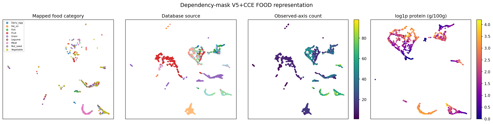
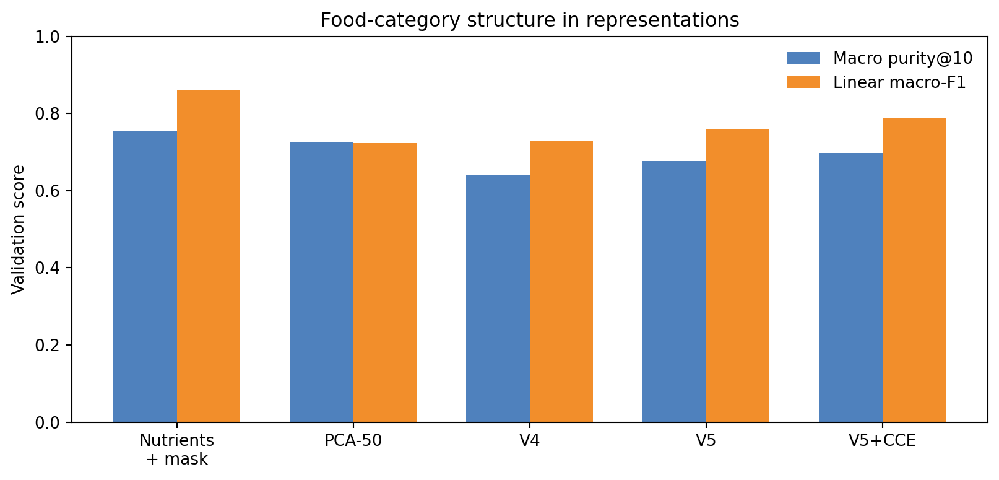
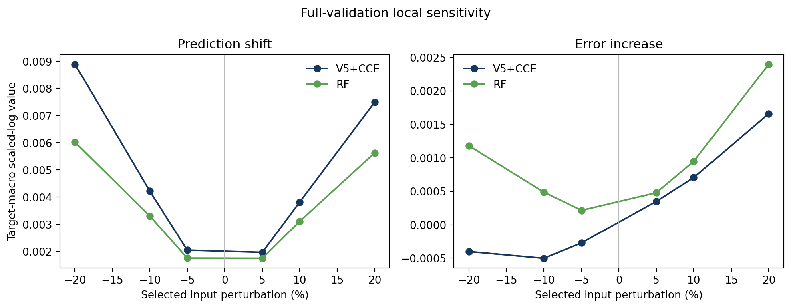
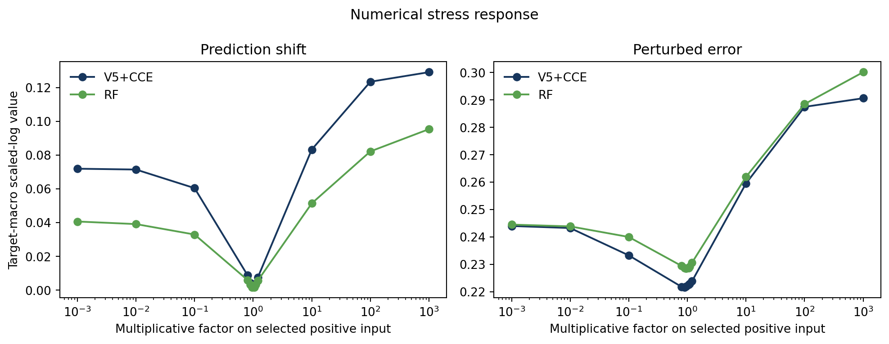

# Food-Composition Foundation Evidence under Explicit Dependency Masking

**Version:** 2026-10-28

**Primary model:** V5+CCE (dependency-mask v1)

**Scope:** mask training audit, UMAP, Taiwan TFDA zero/few-shot transfer, sparse completion, and full-validation sensitivity

## Executive summary

This report reruns the evidence chain from commit `5eb7aeb` under the explicit dependency mask. The mask affects **both training and inference**. Every training profile-target example hides the target plus its registered ancestors and descendants. Validation, complete test, Taiwan zero/few-shot, sparse completion, and sensitivity use the same rule. V4, V5, and V5+CCE were retrained from scratch under this policy; this is not an inference-only mask substitution.

Main findings:

- The registry contains 37 FAO/INFOODS-supported directed relations over 44 axes. Of 187 supervised axes, 144 are singletons. Mean mask size is 1.465, versus 27.717 for the former semantic-family mask. Siblings remain visible.
- V5+CCE reaches **0.3016** macro scaled-log MAE on complete test, the best primary score among the four formal methods in this round.
- On strict Taiwan zero-shot evaluation, V5+CCE scores **0.1922**, reducing scaled-log MAE by **17.3%**, **18.9%**, and **32.3%** relative to XGBoost, RF, and KNN.
- With the same architecture, objective, and optimizer, pretrained initialization reduces Taiwan few-shot error versus scratch by **52.0%**, **45.7%**, and **25.1%** at 8, 32, and 128 shots.
- UMAP and quantitative probes show stronger food-category structure in V5+CCE than in V4/V5, while raw numerical values plus missingness remain stronger. Source-specific coverage is a material confounder.
- Responses to single-input ±10% perturbations are smooth. Deletion and stress conclusions depend on clean error, prediction shift, error increase, and final perturbed error; no one quantity is sufficient.

The old family mask and the new dependency mask define tasks of different difficulty. All comparisons in this report are therefore within the new policy; absolute values should not be used to claim architectural improvement over the old report.

## 1. Shared setup and the new mask

### 1.1 Authority and where masking is applied

The sole authority is the [FAO/INFOODS component-identifier (tagname) standard](https://www.fao.org/infoods/infoods/standards-guidelines/food-component-identifiers-tagnames/en/) for explicit totals, components, subtotals, and structural members. For target `a`, the hidden set is `a + all directed ancestors + all directed descendants`. Unregistered axes are predicted independently. Sibling components stay visible, and the legacy `mask_family` column is unused.

Audit facts:

- 37 directed edges over 44 registered axes;
- 144 singleton and 43 dependency-connected targets;
- mask size 1 to 15, mean 1.465;
- 234 sibling-visibility checks passed;
- no food name, source, family label, or profile identifier is a model input.

Training has 337,048 profile-target tasks per epoch. Every task calls the same `DependencyMaskPolicy` before batching. Evaluation uses the identical object. The checkpoint records the policy hash and `legacy_mask_family_used_for_masking=false`.

### 1.2 Model and metrics

V5+CCE uses three layers, hidden size 192, six heads, ReGLU width 256, and ordered axis-pair bias. V5 executes the shared model twice: pass one creates `[FOOD]`, and pass two uses `detach(h_food)` as its prompt. CCE adds a contrastive objective between two dropout views of the first-pass `[FOOD]`. Official predictions come from second-pass target tokens.

For each axis, `z = log(1 + y/s_a)`, where `s_a` is the positive training median. Errors are averaged within axis and then equally across axes. Macro scaled-log MAE is primary; raw MAE retains the original concentration scale.

### 1.3 Complete-test benchmark under the new mask

| Method | SLMAE | SLRMSE | Raw MAE |
|---|---|---|---|
| V5+CCE | 0.3016 | 0.4910 | 0.3137 |
| XGBoost | 0.3270 | 0.4825 | 0.2624 |
| RF | 0.3322 | 0.4841 | 0.2838 |
| KNN | 0.4047 | 0.5937 | 0.4729 |

V5+CCE has the best primary metric. XGBoost has lower raw MAE and scaled-log RMSE. The Transformer improves typical, scale-balanced error, while the tree baselines retain advantages for raw units or larger log-space misses.

## 2. UMAP and representation structure

The first-pass `[FOOD]` state was extracted for 75,875 train+validation profiles using all observed numerical values and an empty target grid. The empty grid does not invoke one target-specific mask; it audits the full-profile encoder learned under the new training policy. UMAP is descriptive only and was not used for training or checkpoint selection.

| Representation | Macro purity@10 | Macro-F1 | Balanced acc. | Cosine silhouette |
|---|---|---|---|---|
| Nutrients_mask | 0.756 | 0.861 | 0.860 | 0.091 |
| PCA50 | 0.725 | 0.723 | 0.740 | 0.113 |
| V4 | 0.642 | 0.730 | 0.751 | -0.012 |
| V5 | 0.677 | 0.759 | 0.781 | 0.009 |
| V5+CCE | 0.697 | 0.790 | 0.810 | 0.083 |

V5+CCE reaches 0.697 macro purity@10 versus 0.642 for V4, with linear macro-F1 0.790. Raw nutrients plus mask still reach 0.861, so the FOOD embedding is not uniformly more category-informative than its numerical inputs.

Missingness alone reaches 0.597 category macro-F1 and 0.971 source balanced accuracy. Visible source clusters and observation-count gradients are therefore material coverage confounding.

Across UMAP seeds, mean ten-neighbour overlap with the first seed is 0.779. After hiding 10%, 30%, and 50% of observed inputs, mean cosine similarity to the full V5+CCE representation is 0.981, 0.933, and 0.857. UMAP supports representation auditing, not a stand-alone foundation-model claim.

## 3. Taiwan TFDA zero-shot transfer

Taiwan data are excluded from training, tuning, checkpoint selection, and scale estimation. The strict panel contains 2,212 foods, 128,470 food-axis jobs, and 80 axes. The name-novel panel contains 1,789 foods. Every method applies the new dependency mask. RF, XGBoost, and KNN are fit only on the original training partition.

| Method | SLMAE | SLRMSE | Raw MAE |
|---|---|---|---|
| V5+CCE | 0.1922 | 0.3703 | 0.3253 |
| XGBoost | 0.2324 | 0.3731 | 0.3185 |
| RF | 0.2370 | 0.3729 | 0.3332 |
| KNN | 0.2838 | 0.4519 | 0.4968 |

V5+CCE has the lowest strict-panel scaled-log MAE. The 2,000 profile-paired bootstrap intervals against each baseline are in `tables/taiwan_zero_shot_paired_bootstrap.csv`; the name-novel panel preserves the same ranking. Raw and scaled-log metrics can still identify different best models and should be interpreted according to their definitions.

## 4. Taiwan TFDA few-shot adaptation

Only name-novel foods are used. A fixed 400-food test set is held out from an adaptation pool of 1,389 foods. Within each seed, 8 subset 32 subset 128. Pretrained V5+CCE is compared with the same architecture from random initialization. Both use 20 epochs, AdamW, learning rate `1e-4`, batch size 128, and the fixed final epoch without test-based selection.

| Init. | Shots | SLMAE mean | SLMAE SD | Raw MAE mean |
|---|---|---|---|---|
| pretrained | 8 | 0.2033 | 0.0026 | 0.3586 |
| scratch | 8 | 0.4237 | 0.0093 | 1.0460 |
| pretrained | 32 | 0.1974 | 0.0038 | 0.3561 |
| scratch | 32 | 0.3634 | 0.0166 | 0.7284 |
| pretrained | 128 | 0.1829 | 0.0004 | 0.3001 |
| scratch | 128 | 0.2443 | 0.0034 | 0.4850 |

Frozen zero-shot scaled-log MAE on the fixed test set is 0.2000. The pretrained branch scores 0.2033, 0.1974, and 0.1829. Eight-shot adaptation is slightly worse than zero-shot; 32-shot is a small gain; 128-shot improves by 8.5%. Pretraining beats scratch for every shot and seed, providing the most direct sample-efficiency evidence.

## 5. Completion with few visible observations

The experiment selects the 12 most supported validation targets and 200 jobs per target. Each job first hides its target and dependency ancestors/descendants, then keeps 5, 10, 20, 40, or all remaining context values. Finite budgets use three repeats. RF/KNN use their standard dependency-mask training features without extra mask-mix augmentation.

| Method | Budget | Mean visible | SLMAE |
|---|---|---|---|
| KNN | 5 | 5.000 | 0.563 |
| RF | 5 | 5.000 | 0.492 |
| V5+CCE | 5 | 5.000 | 0.380 |
| KNN | 10 | 9.850 | 0.445 |
| RF | 10 | 9.850 | 0.374 |
| V5+CCE | 10 | 9.850 | 0.294 |
| KNN | 20 | 16.728 | 0.345 |
| RF | 20 | 16.728 | 0.294 |
| V5+CCE | 20 | 16.728 | 0.243 |
| KNN | 40 | 27.421 | 0.224 |
| RF | 40 | 27.421 | 0.189 |
| V5+CCE | 40 | 27.421 | 0.203 |
| KNN | all | 34.106 | 0.188 |
| RF | all | 34.106 | 0.132 |
| V5+CCE | all | 34.106 | 0.188 |

V5+CCE scores 0.294 and 0.243 with 10 and 20 visible components and outperforms RF/KNN there; V5 and V5+CCE are close at five components. With 40 and all context values, RF scores 0.189 and 0.132 and becomes the strongest method. The Transformer advantage is therefore concentrated in genuinely sparse context, while RF is strong when context is well observed. The all-context condition exposes more information than the former broad-family task, so the two reports' sparse scores are not direct architecture comparisons.

## 6. Full-validation sensitivity

The audit covers 11,175 validation profiles, 323,809 observed target jobs, and all 187 targets. After dependency masking, one visible positive input is selected deterministically for each eligible job. All models receive the same selected input under factors 0.001 to 1000, ±5%/10%/20%, and deletion. A separate visible-zero probe sets one selected zero to `0.1*s_a`. This provides full target-job coverage with paired sampled inputs; it is not an exhaustive enumeration of every input-target pair.

Prediction shift, error delta, and perturbed error are reported separately. Error delta is perturbed minus clean error; perturbed error includes both baseline accuracy and additional degradation.

| Method | Condition | Prediction shift | Error delta | Perturbed error |
|---|---|---|---|---|
| V5+CCE | factor_0.9 | 0.00422 | -0.00050 | 0.22163 |
| V5+CCE | factor_1.1 | 0.00382 | 0.00071 | 0.22284 |
| V5+CCE | factor_1000 | 0.12913 | 0.06848 | 0.29062 |
| V5+CCE | deletion | 0.05234 | 0.00882 | 0.23095 |
| RF | factor_0.9 | 0.00331 | 0.00049 | 0.22867 |
| RF | factor_1.1 | 0.00311 | 0.00095 | 0.22913 |
| RF | factor_1000 | 0.09537 | 0.07196 | 0.30014 |
| RF | deletion | 0.05463 | 0.02830 | 0.25648 |

Under ±10% perturbations, V5+CCE prediction shifts and error increases are small. Under deletion, its error delta is 0.00882 versus 0.02830 for RF; perturbed errors are 0.23095 and 0.25648. These are model-response diagnostics, not nutritional interventions or causal effects.

Factor 1000 is a numerical stress condition rather than a plausible food. All outputs remain finite. Five hundred profile-paired bootstrap intervals for CCE-minus-RF are provided in `tables/sensitivity_paired_bootstrap.csv`.

## 7. Integrated assessment

1. **The new mask is part of training.** Task generation and every evaluation path share one target-specific policy.
2. **External transfer remains strong.** V5+CCE leads the three baselines on Taiwan scaled-log MAE, including the name-novel subset.
3. **Pretraining improves sample efficiency.** Same-architecture scratch is consistently worse, and 128-shot adaptation clearly beats frozen zero-shot.
4. **UMAP evidence is descriptive.** CCE strengthens category structure, while raw inputs remain stronger and source missingness is highly predictive.
5. **Robustness depends on condition and metric.** Local responses are smooth; deletion and extreme multipliers require separate examination of movement, degradation, and final error.

A defensible summary is:

> After restricting masking to explicit FAO/INFOODS-supported dependencies and predicting all other axes independently, the retrained V5+CCE still shows clear zero-shot transfer to the Taiwan database. Same-architecture few-shot ablation further shows that pretraining materially improves sample efficiency. Representation and sensitivity audits confirm meaningful cross-axis use while identifying database missingness and context coverage as important confounders.

## 8. Limitations

1. The old and new masks define different tasks. The narrower new task has lower absolute difficulty, so cross-report score changes are not architectural gains.
2. Taiwan covers 80 of 187 supervised axes. Exact name novelty does not prove semantic novelty.
3. Few-shot evaluation uses one fixed test split and three seeds. Shared hyperparameters control the comparison but are not separately optimal.
4. UMAP uses an empty query grid and describes the encoder's full-profile state rather than a specific completion query.
5. Sensitivity samples one input per job rather than every input-target pair, and perturbations may violate food chemistry or mass balance.
6. Neural results come from one pretrained seed, so pretraining-seed uncertainty is unmeasured.

## 9. Reproducibility and attachments

The report package contains only aggregate tables, figures, and hashes. It excludes checkpoints, raw Taiwan data, and row-level predictions. Analysis manifests record data, policy, checkpoint, and code hashes.
