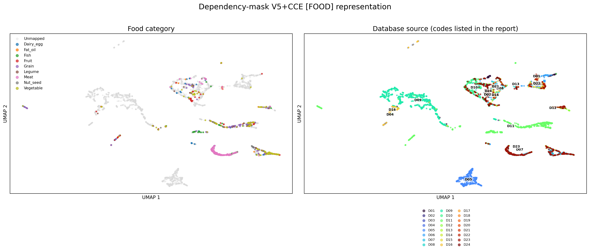
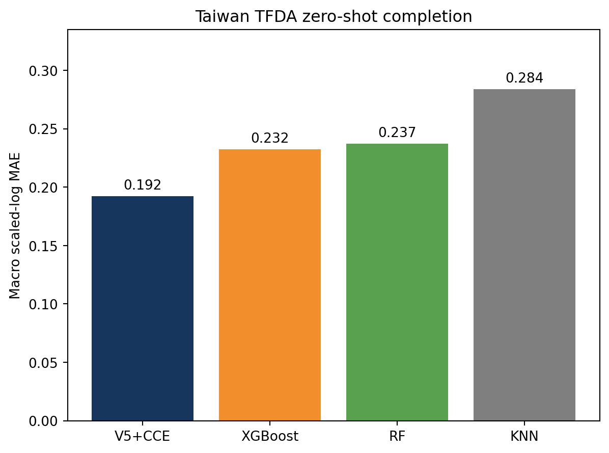
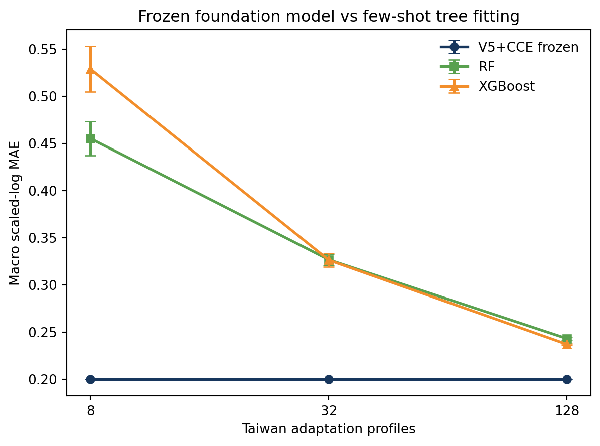
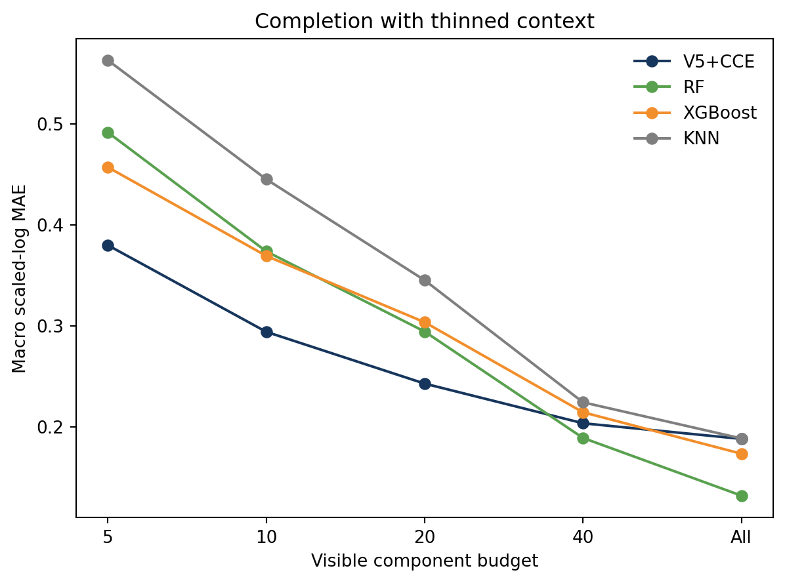
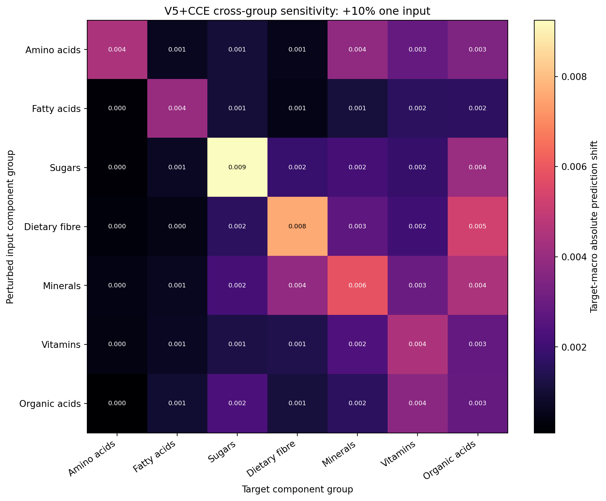
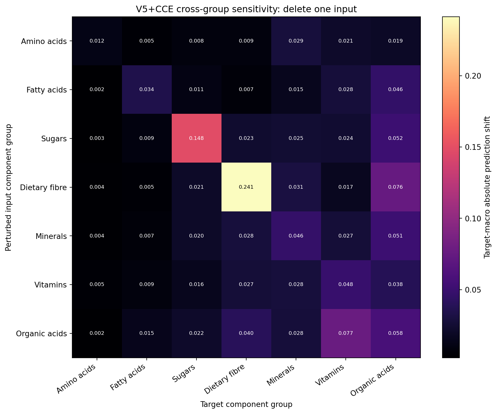
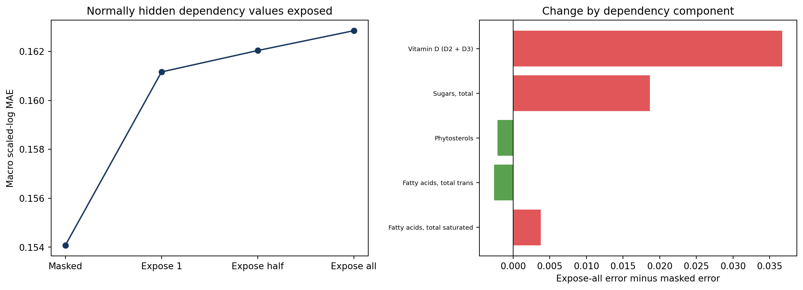
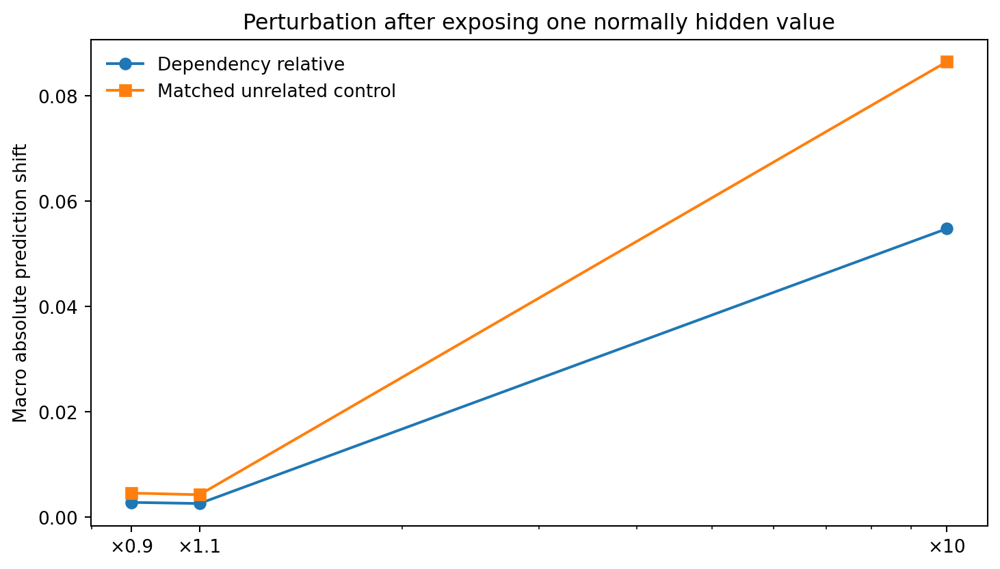

# Food-Composition Foundation Evidence under Explicit Dependency Masking: Revised Analyses

**Version:** 2026-10-28 r2

**Primary model:** V5+CCE (dependency-mask v1)

**Scope:** mask audit, food/database UMAP, Taiwan zero/few-shot, sparse completion, INFOODS group sensitivity, dependency exposure ablation

## Executive summary

The dependency mask affects **both training and inference**. Every training profile-target task hides the target plus its directed ancestors and descendants; validation, complete test, Taiwan transfer, and all analyses use the same policy. V4, V5, and V5+CCE were trained from scratch under this mask.

This revision keeps only food-category and database-source UMAP views; compares frozen V5+CCE with Taiwan few-shot RF/XGBoost without a scratch Transformer; restricts sparse completion to V5+CCE, RF, XGBoost, and KNN; and adds an FAO/INFOODS component-group sensitivity matrix plus a dependency exposure ablation.

Key results:

- Frozen V5+CCE scores **0.2000** on the fixed Taiwan test. RF scores **0.4551/0.3266/0.2430** at 8/32/128 shots; XGBoost scores **0.5287/0.3262/0.2369**. The frozen model is better at every budget.
- For +10% input perturbations, within-group prediction shift is **0.00550** versus **0.00179** between groups; deletion gives **0.08410** versus **0.02230**.
- The inference-only dependency exposure ablation does **not** show stronger use of strict dependency relatives than ordinary controls. Exposing all normally hidden relatives changes SLMAE from **0.1541** to **0.1628** and therefore worsens accuracy.

## 1. Shared setup and mask

The graph contains only totals, components, subtotals, and structural members explicitly supported by FAO/INFOODS tagname definitions. It has 37 directed edges over 44 axes; 144 of 187 supervised targets are singletons. A target mask is `target + all directed ancestors + all directed descendants`; siblings remain visible and the legacy `mask_family` column is unused.

| Method | SLMAE | SLRMSE | Raw MAE |
|---|---|---|---|
| V5+CCE | 0.3016 | 0.4910 | 0.3137 |
| XGBoost | 0.3270 | 0.4825 | 0.2624 |
| RF | 0.3322 | 0.4841 | 0.2838 |
| KNN | 0.4047 | 0.5937 | 0.4729 |

## 2. UMAP: food category and database

UMAP uses the first-pass V5+CCE `[FOOD]` representation for 4,000 validation profiles. Category and database labels are used only for colouring. Observation-count and single-nutrient gradient panels have been removed.

| Representation | Macro purity@10 | Macro-F1 | Balanced acc. |
|---|---|---|---|
| Values+mask | 0.7563 | 0.8614 | 0.8598 |
| V4 | 0.6424 | 0.7296 | 0.7505 |
| V5 | 0.6767 | 0.7592 | 0.7814 |
| V5+CCE | 0.6973 | 0.7895 | 0.8096 |

Database codes are listed below.

| Code | Source key | Database | UMAP n |
|---|---|---|---|
| D01 | afcd | Australian Food Composition Database | 107 |
| D02 | anfood_2_0 | FAO/INFOODS AnFooD 2.0 | 22 |
| D03 | bangladesh_fct_2013 | Bangladesh Food Composition Table 2013 | 15 |
| D04 | biofoodcomp_4_0 | FAO/INFOODS BioFoodComp 4.0 | 51 |
| D05 | bls_4_0 | German Nutrient Database BLS 4.0 | 405 |
| D06 | ciqual | ANSES-Ciqual | 194 |
| D07 | cnf | Canadian Nutrient File | 326 |
| D08 | cofid | UK CoFID | 141 |
| D09 | efsa_eu_fcdb_2013 | EFSA EU Food Composition Database | 830 |
| D10 | fndds | USDA FNDDS | 273 |
| D11 | foodb | FooDB | 622 |
| D12 | frida | Frida FoodData, Denmark | 79 |
| D13 | lesotho_fct_2006 | Lesotho Food Composition Table 2006 | 12 |
| D14 | mext_japan_2023 | Japan MEXT Food Composition Tables | 133 |
| D15 | norway | Norwegian Food Composition Database | 87 |
| D16 | phyfoodcomp_1_0 | FAO/INFOODS/IZiNCG PhyFoodComp 1.0 | 112 |
| D17 | smiling_cambodia_2013 | SMILING Cambodia FCT 2013 | 6 |
| D18 | smiling_indonesia_2013 | SMILING Indonesia FCT 2013 | 6 |
| D19 | smiling_laos_2013 | SMILING Laos FCT 2013 | 6 |
| D20 | smiling_thailand_2013 | SMILING Thailand FCT 2013 | 7 |
| D21 | smiling_vietnam_2013 | SMILING Vietnam FCT 2013 | 11 |
| D22 | swiss_fcdb_7_1 | Swiss Food Composition Database 7.1 | 73 |
| D23 | usda_sr_legacy | USDA Standard Reference Legacy | 431 |
| D24 | wafct_2019 | FAO/INFOODS West Africa FCT 2019 | 51 |

Missingness alone reaches about 0.971 source balanced accuracy, so database separation is materially confounded by coverage patterns.

## 3. Taiwan zero-shot

Taiwan is excluded from training, scale estimation, tuning, and checkpoint selection. The strict panel contains 2,212 foods, 128,470 food-axis jobs, and 80 axes.

| Method | SLMAE | SLRMSE | Raw MAE |
|---|---|---|---|
| V5+CCE | 0.1922 | 0.3703 | 0.3253 |
| XGBoost | 0.2324 | 0.3731 | 0.3185 |
| RF | 0.2370 | 0.3729 | 0.3332 |
| KNN | 0.2838 | 0.4519 | 0.4968 |

V5+CCE has the best primary scaled-log MAE, while raw MAE can still favour XGBoost.

## 4. Taiwan few-shot: frozen model versus tree fitting

A fixed 400 name-novel food test is held out from 1,389 adaptation foods. The 8-shot subset first uses missingness-only set coverage so every test axis has at least one label, then fills randomly; subsets are nested through 32 and 128. V5+CCE remains frozen. RF and XGBoost use their formal configurations and are fit per axis only on the selected Taiwan profiles. There is no scratch Transformer and no Transformer fine-tuning.

| Method | Profiles | SLMAE mean | SD |
|---|---|---|---|
| RF | 8 | 0.4551 | 0.0179 |
| V5+CCE frozen | 8 | 0.2000 | 0.0000 |
| XGBoost | 8 | 0.5287 | 0.0243 |
| RF | 32 | 0.3266 | 0.0058 |
| V5+CCE frozen | 32 | 0.2000 | 0.0000 |
| XGBoost | 32 | 0.3262 | 0.0074 |
| RF | 128 | 0.2430 | 0.0017 |
| V5+CCE frozen | 128 | 0.2000 | 0.0000 |
| XGBoost | 128 | 0.2369 | 0.0010 |

Even at 128 Taiwan foods, XGBoost reaches 0.2369 and RF 0.2430, compared with 0.2000 for frozen V5+CCE. This directly demonstrates external sample efficiency from pretraining.

## 5. Completion with few visible observations

The panel fixes 12 high-support targets and 200 validation jobs per target. Dependency masking is applied first, followed by random retention of 5, 10, 20, 40, or all context values. Only the four requested methods are retained.

| Method | Visible | SLMAE mean | SD |
|---|---|---|---|
| KNN | 5 | 0.5633 | 0.0069 |
| RF | 5 | 0.4918 | 0.0077 |
| V5_CCE | 5 | 0.3799 | 0.0078 |
| XGBoost | 5 | 0.4572 | 0.0043 |
| KNN | 10 | 0.4453 | 0.0029 |
| RF | 10 | 0.3738 | 0.0099 |
| V5_CCE | 10 | 0.2940 | 0.0042 |
| XGBoost | 10 | 0.3693 | 0.0086 |
| KNN | 20 | 0.3452 | 0.0025 |
| RF | 20 | 0.2943 | 0.0021 |
| V5_CCE | 20 | 0.2427 | 0.0061 |
| XGBoost | 20 | 0.3035 | 0.0020 |
| KNN | 40 | 0.2241 | 0.0022 |
| RF | 40 | 0.1888 | 0.0027 |
| V5_CCE | 40 | 0.2033 | 0.0018 |
| XGBoost | 40 | 0.2142 | 0.0005 |
| KNN | all | 0.1883 | nan |
| RF | all | 0.1316 | nan |
| V5_CCE | all | 0.1879 | nan |
| XGBoost | all | 0.1731 | nan |

V5+CCE leads at 5, 10, and 20 visible values. RF leads at 40 and all, with XGBoost second. The foundation-model advantage is concentrated in genuinely sparse context.

## 6. FAO/INFOODS component-group sensitivity

### 6.1 Classification authority

One source is used: the [FAO/INFOODS and EuroFIR component nomenclature workshop report](https://www.fao.org/fileadmin/templates/food_composition/documents/upload/9IFDCReportfinal.pdf), Annex 1, with names checked against [INFOODS tagnames](https://www.fao.org/infoods/infoods/standards-guidelines/food-component-identifiers-tagnames/en/). The Annex hierarchy is labelled a draft proposition, so only seven clear groups are registered: amino acids, fatty acids, sugars, dietary fibre, minerals, vitamins, and organic acids. Unlisted axes remain unclassified. The mapping covers 135/252 axes and 132 supervised targets. It is used only for sensitivity aggregation and never for masking or model input.

### 6.2 Cross-group matrix

After dependency masking, one positive visible input is selected from every available input group for each target job. The audit contains 58,197 input-target pairs.

| Condition | Relation | Prediction shift | Error delta | Pairs |
|---|---|---|---|---|
| deletion | between_group | 0.0223 | 0.0013 | 45269 |
| deletion | within_group | 0.0841 | 0.0349 | 12928 |
| minus_10pct | between_group | 0.0020 | -0.0002 | 45269 |
| minus_10pct | within_group | 0.0061 | -0.0002 | 12928 |
| plus_10pct | between_group | 0.0018 | 0.0002 | 45269 |
| plus_10pct | within_group | 0.0055 | 0.0010 | 12928 |

The diagonal is about 3.1 times the off-diagonal mean for +10% and 3.8 times for deletion. Sugars and dietary fibre have the strongest diagonal responses, although fibre cells have low support. These are predictive associations, not causal nutritional interventions.

## 7. Dependency-family exposure and perturbation ablation

This experiment uses only target-specific ancestors/descendants that the current policy normally hides; siblings are already visible. It covers 6,889 jobs, 32 targets, and 5 dependency components.

| Condition | SLMAE | Shift vs masked | Axes | Jobs |
|---|---|---|---|---|
| standard_mask | 0.1541 | 0.0000 | 32 | 6889 |
| expose_one | 0.1612 | 0.0237 | 32 | 6889 |
| expose_half | 0.1620 | 0.0256 | 32 | 6889 |
| expose_all | 0.1628 | 0.0290 | 32 | 6889 |

Exposing more dependency values does not improve accuracy. It is an out-of-distribution inference condition because training never allowed a target to see these relatives.

One exposed dependency value and a matched unrelated visible control are then perturbed separately.

| Factor | Dependency shift | Control shift | Dependency Δerror | Control Δerror |
|---|---|---|---|---|
| 0.9000 | 0.0028 | 0.0046 | -0.0007 | 0.0003 |
| 1.1000 | 0.0026 | 0.0042 | 0.0007 | 0.0004 |
| 10.0000 | 0.0548 | 0.0865 | 0.0177 | 0.0400 |

Revealing one dependency value shifts prediction by 0.02371, versus 0.02991 for the control. The profile-bootstrap 95% interval for dependency minus control is [-0.01124, 0.00091]. Dependency perturbation shifts are also lower overall at all three factors.

This ablation therefore does **not** establish that the trained model strongly uses these strict parent-child relations when they are exposed only at inference. It supports retaining the mask because inference-only unmasking worsens error. The scientific relation itself comes from INFOODS definitions. Quantifying leakage from omitting the mask would require a separately trained matched no-dependency-mask model.

## 8. Conclusions and limitations

1. The new mask is part of training and every evaluation path.
2. Frozen V5+CCE beats RF/XGBoost fit on 8–128 labelled Taiwan foods, supporting external sample efficiency.
3. V5+CCE leads sparse completion at 5–20 visible values; trees lead with richer context.
4. Broad INFOODS groups show stronger within-group than between-group response, but this is associative.
5. Inference-only strict-dependency exposure is a negative result and cannot prove learned dependency use.
6. UMAP database separation is strongly confounded by missingness; Taiwan covers 80/187 targets; neural evidence uses one pretrained seed.

## 9. Reproducibility and attachments

The package contains aggregate tables, figures, hashes, and scripts. It excludes checkpoints, raw data, and row-level predictions.
